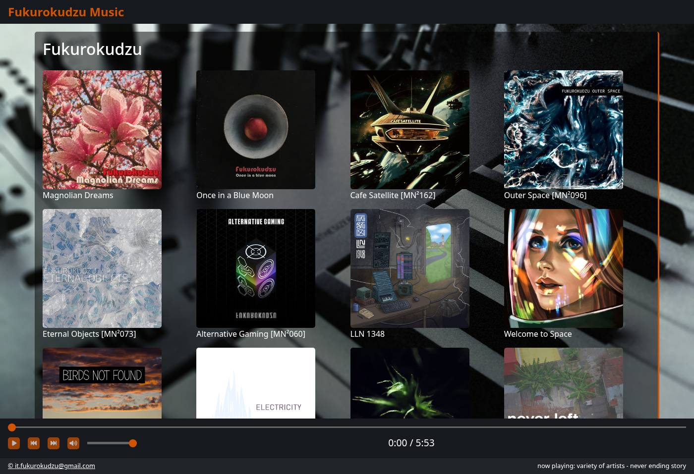

# musician-cms

A simple self-hosted Ruby on Rails CMS for musician portfolios — publish releases, stream tracks and customize the look, all from a built-in admin panel.

<p align="center">
  
</p>

<p align="center">
  
</p>

## ⚠️ Status: Alpha

This project is in active development. Expect breaking changes, incomplete features and rough edges. Do not use it in production without reviewing the code and keeping backups.

## What it does

`musician-cms` is aimed at musicians who want a small personal music site: an artist page with releases, cover art, a persistent audio player and a lightweight admin panel for uploading music. No accounts for visitors, no comments, no bloat — just a clean portfolio site you can host yourself.

## Features

- **Public site**
  - Artist pages with release grids grouped by year
  - Release pages with tracklists, cover art and optional ZIP downloads
  - Built-in audio player that persists across page navigation (Turbo)
  - Random "now playing" track when you first arrive
- **Admin panel**
  - Upload releases: audio files, cover art, titles, dates and statuses (draft/published/archived)
  - Manage artists, tracks, play counters and library paths
  - Scan a local music folder and import new releases automatically (Sidekiq job)
  - Theme editor: colors, background image and corner radius — live CSS variables, no code changes needed
  - Configurable site title, description, locale (EN/RU) and footer contact link (email or URL)
- **Under the hood**
  - Ruby on Rails 8.1, Hotwire (Turbo + Stimulus)
  - PostgreSQL, Redis + Sidekiq for background jobs
  - Active Storage for covers and audio
  - Fully containerized: one `docker compose up` brings up web, database, Redis and workers

### Release statuses

- **Draft** — visible only in the admin panel; not shown on the public site and not accessible by direct URL.
- **Published** — visible publicly (listings, release page, player, ZIP download when enabled).
- **Archived** — removed from the public site (hidden from listings, not accessible by direct URL, not playable/downloadable), but kept in the admin panel with all data and can be restored by changing status (e.g. back to draft or published).

## Installation (Docker)

### Requirements

- Docker Engine with BuildKit
- Docker Compose v2

### Quick start

```bash
git clone git@github.com:Fukurokudzu/musician-cms.git
cd musician-cms
cp .env.example .env
./bin/prod-deploy
```

The helper runs `docker compose up -d --build` and automatically fills in
`GIT_COMMIT`/`GIT_BRANCH` from the current checkout (used by the *Admin → About*
diagnostics). Any extra arguments are forwarded to Compose, e.g.
`./bin/prod-deploy --build`.

If you prefer, the plain Compose command works too:

```bash
docker compose up -d --build
```

That's it. On first run the entrypoint generates Rails credentials and prepares the database automatically. See [DEPLOY.md](DEPLOY.md) for deployment details.

The web app will be available at `http://localhost:3003` (the port is mapped to `127.0.0.1`, put your reverse proxy in front for HTTPS).

### First login

1. Go to `http://localhost:3003/sign_in`
2. Sign in with the default credentials: **admin@admin / admin**
3. **Change the password immediately** in the *System* tab of the admin panel

### Music library

By default the compose file mounts a named volume to `/rails/app/music`. You can either copy files into the volume or replace it with a bind mount in `docker-compose.yml`:

```yaml
volumes:
  - /path/to/your/music:/rails/app/music:ro
```

Then use the *Library* tab in the admin panel to check the library path and run a scan — releases and tracks found in the folder are imported for you.

### Volumes

| Volume | Purpose |
|---|---|
| `postgres_data` | PostgreSQL data |
| `storage_data` | Active Storage uploads (covers, audio) |
| `music_library` | Mounted music library (or bind mount a host path) |
| `credentials_data` | Rails credentials persistence |

## Documentation

- [DEPLOY.md](DEPLOY.md) — deployment details: volumes, build caching, credentials and the music library

## Live example

[music.fukurokudzu.ru](https://music.fukurokudzu.ru) — the site in the screenshot above.
